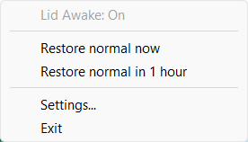
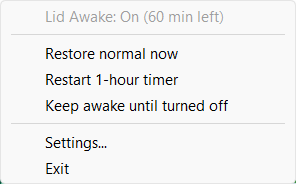

# Lid Awake

Lid Awake is a Windows 10/11 tray app that can keep your laptop awake when its lid is closed.

## Install or run standalone

Download a package from the [latest release](https://github.com/Broklam/LidAwake/releases/latest):

- **Setup:** open `LidAwake-v…-Setup.exe` and click **Install** to use your account's Programs folder (normally `%LOCALAPPDATA%\Programs\Lid Awake`). Enter a different path or click **Browse** to choose a new or empty folder. Setup adds a Start menu shortcut and an entry in Windows Settings > Apps. It does not require administrator privileges. If Lid Awake is already installed, Setup uses its existing folder. To change folders, uninstall first, then run Setup again.
- **Standalone:** open `LidAwake-v…-Portable.exe` to run it without installing. On the first manual launch, choose **Run standalone** or **Install**. Tick **Don't ask again** to remember your choice. If you remember Install, later launches of the portable file open the installed copy; if that copy is removed, the choices appear again. Use **Show install options next time** in Settings to reset the choice.

Older releases may contain just `LidAwake-v….exe`, which is a standalone executable. No extra runtime download is required. The installed app and automatic startup bypass the launch choice.

To uninstall, first choose **Exit** from the tray menu, then remove Lid Awake in Windows Settings > Apps. Your saved preferences are kept. To remove a standalone copy, exit the app and delete its EXE.

## Use the tray menu

Click the laptop icon by the clock. Look under the **^** arrow if Windows puts it among the hidden icons.

- Click **Keep awake with lid closed** to turn it on. The icon turns green with a checkmark.
- Choose **Keep awake for 1 hour** when off, or **Restore normal in 1 hour** when already on. The icon tooltip and tray menu show the remaining time. You can restart the timer or switch back to staying awake until you turn it off.
- Choose **Restore normal now** or **Exit** to restore your original lid settings immediately.

It works on battery and when plugged in. Windows can still sleep after its usual idle timeout or when you choose Sleep. If the app is forcibly stopped while on, open it again to restore the settings it saved. The app opens with the override off.

In **Settings**, enable **Start Lid Awake when I sign in to Windows** if desired. If you move a standalone EXE, open Settings from its new location and save to update the startup entry.

## Updates

Lid Awake checks [GitHub releases](https://github.com/Broklam/LidAwake/releases/latest) shortly after startup and every six hours while it runs. When a newer release is available, it downloads, installs, and relaunches the app automatically. Installed and standalone copies keep their existing paths and settings. Clear **Automatically check for and install updates** in Settings to turn this off.

Lid Awake verifies the download and waits until Settings and the tray menu are closed and the original lid behavior has been restored before restarting. If the new version fails to start, the updater attempts to restore the previous executable.

## Build

Run `powershell -NoProfile -ExecutionPolicy Bypass -File .\Package.ps1` to create both packages in `dist`. Pass `-Version 1.2.3.0` to choose a four-part version (the revision must be zero). To build a single EXE instead, run `powershell -NoProfile -ExecutionPolicy Bypass -File .\Build.ps1`. The icons are embedded in the EXE.

Every push to `main` runs the GitHub Actions release workflow. It builds both packages, creates a numbered release, and attaches them. The major and minor version come from `Program.cs`; the patch number is the workflow run number. You can also run the workflow manually from the Actions tab.

The separate **Windows tests** workflow runs for pushes to `main` and pull requests, including pull requests from forks. It tests release selection and downloads with local fixtures, launch preferences, an isolated install and shortcut, deferred updates, replacement, and rollback; it does not change real power settings or install the app. Run the same tests locally with `powershell -NoProfile -ExecutionPolicy Bypass -File .\tests\Test.ps1`. GitHub may require a maintainer to approve workflows from some first-time contributors.
